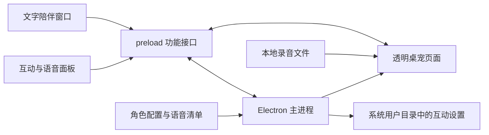

# 架构

Electron 主进程管理透明置顶窗口、托盘、动作分发、本地设置、语音清单和模型请求。桌宠页面负责显示、CSS 动作和音频播放；互动面板负责控制；聊天窗口提供文字对话、本地记忆及可选语音输入。

页面开启上下文隔离、沙箱，关闭 Node 集成，禁止跳转与外部窗口。preload 只暴露具体能力，不暴露任意 IPC 或任意文件读取。

`companion.js` 统一定义可用互动和设置范围。当前界面与未来 AI 通过 `interaction:execute` 共用主进程分发器，`interaction:catalog` 提供可调用命令、语音和表情包目录。接口参数见 `INTERACTIONS.md`。媒体真实路径限制在各自目录内，检查格式、文件类型和大小。清单文本以纯文本呈现。

缩放和音量通过 IPC 通知桌宠页面。设置先写临时文件再重命名，保存操作串行执行。休息时停止录音并拒绝点播和一般动作，唤醒恢复。

基础模式通过主进程模式校验阻止模型请求；陪伴模式在主进程访问 OpenAI 兼容接口。API 密钥由 safeStorage 加密后保存。每轮聊天最多发送最近 24 条对话和用户明确保存的长期记忆；聊天记录和长期记忆分开持久化并可分别清除。媒体工具只在本轮用户文字符合明确请求规则时提供给模型，且主进程再次验证意图、素材 ID 和本地播放列表后执行。助手模式保留为不可选状态，待 DSH 集成完成。

录音在桌宠页面播放，新录音停止前一条；播放状态回传互动面板。默认音频清单为空。测试在独立临时应用与数据目录生成静音播放的测试 WAV，不使用或改动真实角色音频。

表情包从原生文件选择器导入，复制到项目 `assets/stickers/`，重名时添加唯一后缀。目录索引以文件名作为稳定 ID，显示与收起经统一接口执行。图片在桌宠气泡显示 6.5 秒；不经过聊天 API 或 QQ。项目默认不附带表情包图片。
